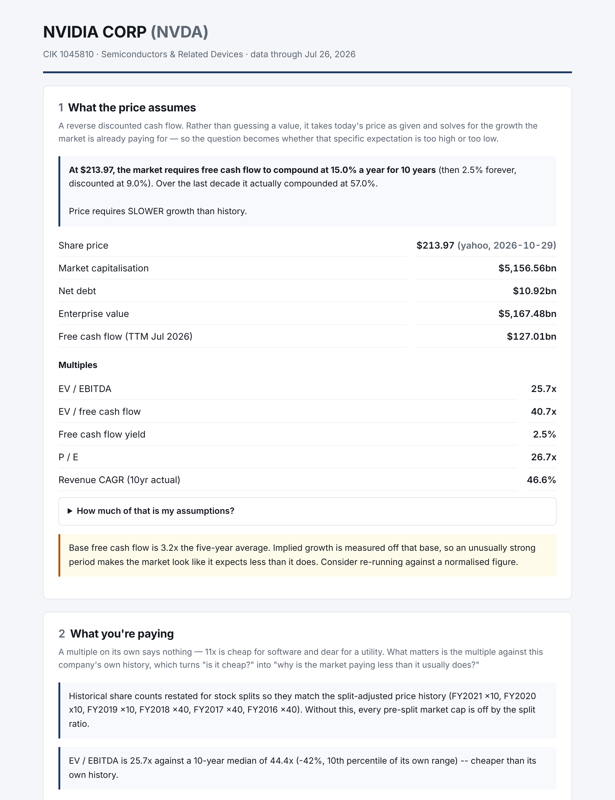

# edgar_analyst

**Ticker in → a 10-year financial model, an accounting red-flag screen, a reverse DCF, and a summary of what changed in the latest 10-K.** All of it comes from free SEC data and takes a few seconds per company.



Spreading a decade of financials by hand takes most of a day, and that's before any analysis. This tool does the mechanical work, then points you at the questions worth asking: what growth the price already assumes, which accounting numbers look odd, and what management quietly rewrote in this year's annual report.

---

## What one run produces

| File | What it is |
|---|---|
| `TICKER_brief.html` | **Read this first.** A one-page brief: what the price assumes, what you're paying vs. history, red flags, 10-K changes, data warnings |
| `TICKER_Company.xlsx` | The model: 10 years of income statement, balance sheet and cash flow, ~45 ratios, a trailing-twelve-month column, plus Red Flags, Reverse DCF and Multiples sheets, and an audit trail showing which XBRL tag fed every line |
| `comps.xlsx` | Every ticker in the run side by side, with identical definitions applied to each |

## The four modules

1. **Filing diff.** Downloads the two most recent 10-Ks, splits each into its numbered Items, and ranks sections by how much changed. Motivated by Cohen, Malloy & Nguyen, *"Lazy Prices"* (2020): firms that change their 10-K language tend to underperform.
2. **Statement normalizer.** XBRL facts → clean, comparable annual statements. This is the foundation, and most of the code. See *Hard problems* below.
3. **Red-flag screener.** Beneish M-score, Altman Z (or Z'' where appropriate), and 16 plain-language checks such as receivables outgrowing revenue, accruals and FCF conversion. A 0–100 composite score is provided for sorting only.
4. **Reverse DCF.** Instead of guessing a value, it takes today's price as given and solves for the free-cash-flow growth the market requires, then compares that to what the company actually delivered. Includes a WACC × terminal-growth sensitivity grid. Assumptions (9% WACC, 2.5% terminal, 10 years) live in `config.py`, where you can see and defend them.

---

## Quick start

Requires Python 3.10+.

**macOS, no Terminal:** double-click `1 - SETUP (double-click me first).command` once. It asks for your name and email (the SEC requires these), installs everything and runs the self-test. After that, use `2 - RUN (double-click me).command`.

**Any OS:**

```bash
python3 -m venv .venv && source .venv/bin/activate
pip install -r requirements.txt
echo "Your Name you@example.com" > sec_user_agent.txt   # SEC requires a real name + email
python selftest.py                                       # 36 checks against real filings
python -m edgar_analyst NVDA                             # one company
python -m edgar_analyst VST CEG NRG TLN --comps          # a peer group + comps sheet
```

Output goes to `./output/`. Options: `--years N`, `--comps`, `--csv`, `--no-filings` (skip the 10-K diff), `--no-prices`, `--wacc 0.09`, `--terminal-growth 0.025`, `--output-dir PATH`, `--no-cache`, `--quiet`.

You can also set the SEC identity with the `SEC_USER_AGENT` environment variable instead of the file.

**Prices** come from Yahoo Finance's public chart endpoint by default: free, no key needed, with 10 years of daily history and split events. A dated row in `prices.csv` overrides it on purpose. An optional market-data API key can be supplied through the `BARCHART_API_KEY` environment variable.

---

## Hard problems, and how they're handled

"Just download the XBRL" doesn't work. These are the reasons, and most of the code exists to deal with them.

- **Companies switch tags mid-history.** Taking only the modern revenue tag silently drops the early years and breaks every CAGR. The normalizer picks the best-covered tag, gap-fills from alternates, and records each choice on a coverage sheet.
- **Tag order encodes judgment.** `Revenues` is checked before the contract-revenue tag because Walmart's contract revenue is $642.6bn against $648.1bn of actual revenue. The gap is membership income, and at Costco that gap *is* the business model.
- **Fiscal years don't line up.** Apple ends in September, Walmart in January. Each year is labeled by the calendar year it mostly covers, so peers sit side by side correctly.
- **Restatements.** The latest-filed value wins, and restated years are flagged, because a quiet restatement is itself a signal.
- **Corporate reorganizations.** XOM's ticker points to a new CIK with no 10-K history. The program finds the predecessor and says it switched.
- **Recast filings.** Disney's FY2017 balance sheet appears in no 10-K, only in an 8-K recast after the Fox deal.
- **Stale annuals.** A TTM column is built as *last fiscal year + YTD now − YTD a year ago*, because Q4 is never filed as a 10-Q.

### Bugs found while building it

Each of these produced plausible-looking wrong numbers before it was caught:

1. **Ticker reassignment.** PARA now points to Banzai International, not Paramount. The program warns when a CIK has ≤6 years of history.
2. **SPAC heritage.** Pre-merger years are the shell company's financials. These are detected from former company names.
3. **10-K/A amendments** read as "100% rewritten" in the filing diff. They are excluded, with a size-ratio guard.
4. **Double-escaped HTML entities** broke 10-K Item parsing. Fixed by decoding repeatedly.
5. **Section boundaries need every Item,** or Item 7A swallows the financial statements.
6. **Net debt read from the wrong line,** which made Vistra look like it had net cash.
7. **Beneish flags fast growers mechanically** (NVIDIA). The brief now says so instead of implying manipulation.
8. **Altman Z on structurally levered sectors.** Utilities and IPPs would flag every year, so they're exempted.
9. **Reverse DCF on a tiny base.** Constellation implied 48% growth. The program now warns when the base isn't meaningful.
10. **Split-adjusted prices × unadjusted share counts.** This made NVIDIA's FY2016–18 market caps wrong by 40×. Share counts are now restated per year to match the price basis.
11. **EDGAR's company search is a prefix match.** "ExxonMobil" finds nothing, so a shorter-prefix fallback was added.

---

## Verification

```bash
python selftest.py   # 36 passed, 0 failed
```

The self-test checks figures against the actual filings (Apple, Microsoft, Walmart, Costco, NVIDIA, Disney and others), balance sheet identities, TTM arithmetic, that the DCF solver inverts correctly, red-flag invariants, 10-K section parsing, multiples reproducing from their inputs, and regression cases for every fix above. Across a 50-company sample, assets = liabilities + equity holds for 498 of 499 company-years. The one exception is flagged in its own workbook rather than passed off as clean.

## Known limitations

- **Banks and insurers** need their own template, so operating income, EBITDA and ROIC are left blank rather than fabricated.
- **Foreign private issuers** (20-F filers, most ADRs) are not supported.
- **10-K Item parsing is heuristic.**
- **The Yahoo endpoint is unofficial.** `prices.csv` is the fallback.
- **Red flags and the reverse DCF are screens, not conclusions.** A triggered flag is a question for the filing.

## Code layout

```
edgar_analyst/
  client.py      SEC access: caching, rate limiting (well under 10 req/s), errors
  taxonomy.py    XBRL tag -> standard line item, ordered candidates per line
  normalize.py   Raw facts -> clean annual statements (the hard part)
  interim.py     10-Q data -> TTM column
  metrics.py     Every ratio, defined once
  filings.py     10-K download, Item splitting, section diff (module 1)
  redflags.py    Beneish, Altman, plain-language checks (module 3)
  valuation.py   Reverse DCF solver + sensitivity (module 4)
  multiples.py   Current and historical multiples, split-basis handling
  prices.py      Price sources and fallback order
  export.py / htmlreport.py   Excel workbook and HTML brief
  pipeline.py / cli.py        Ticker -> everything
selftest.py      Verification against real filings
```

Longer notes on the normalizer and TTM column are in [docs/technical-notes.md](docs/technical-notes.md).

Built with Python, requests, pandas and openpyxl. No paid data required. MIT licensed.
